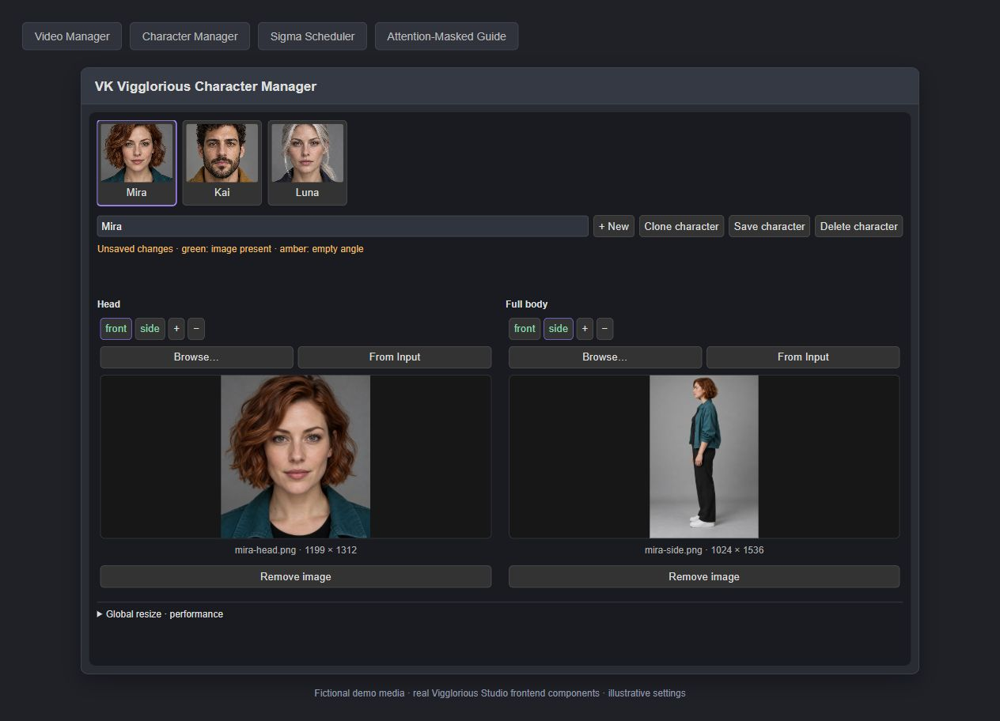
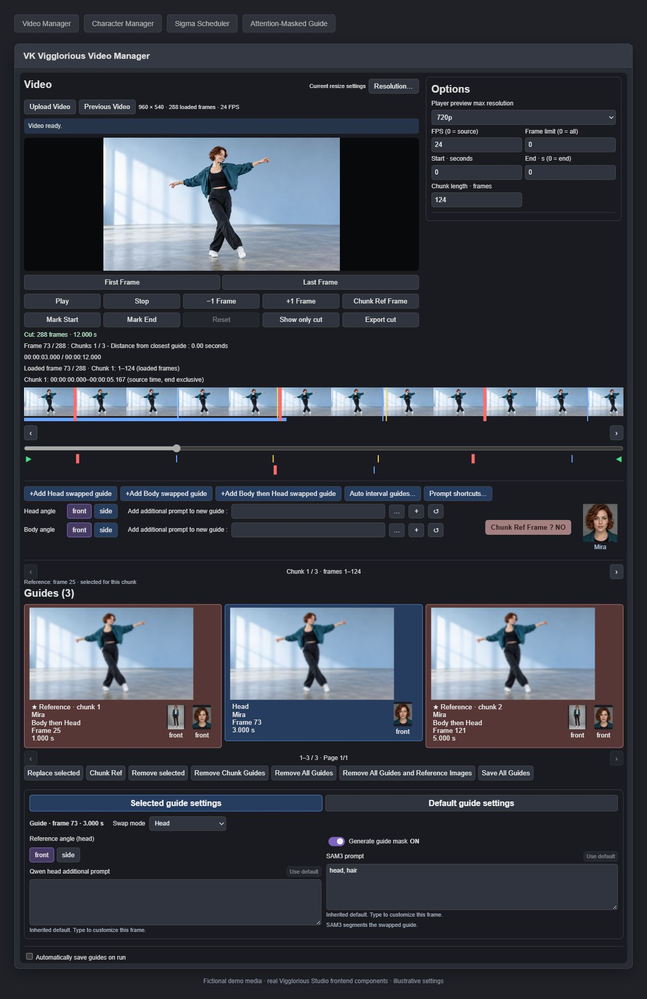
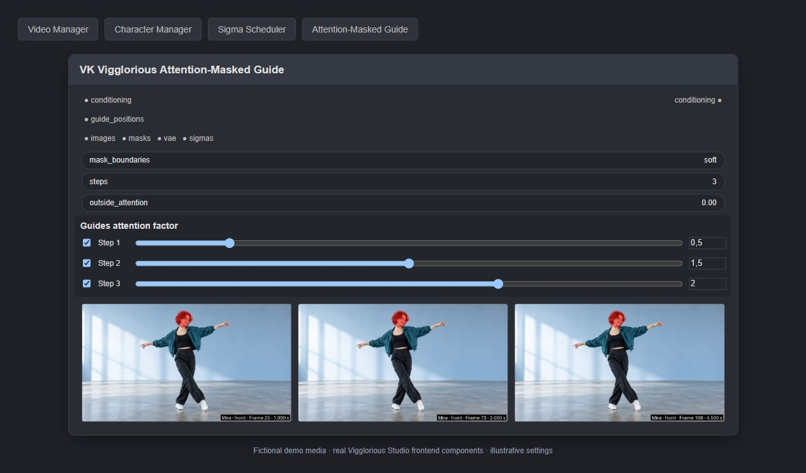
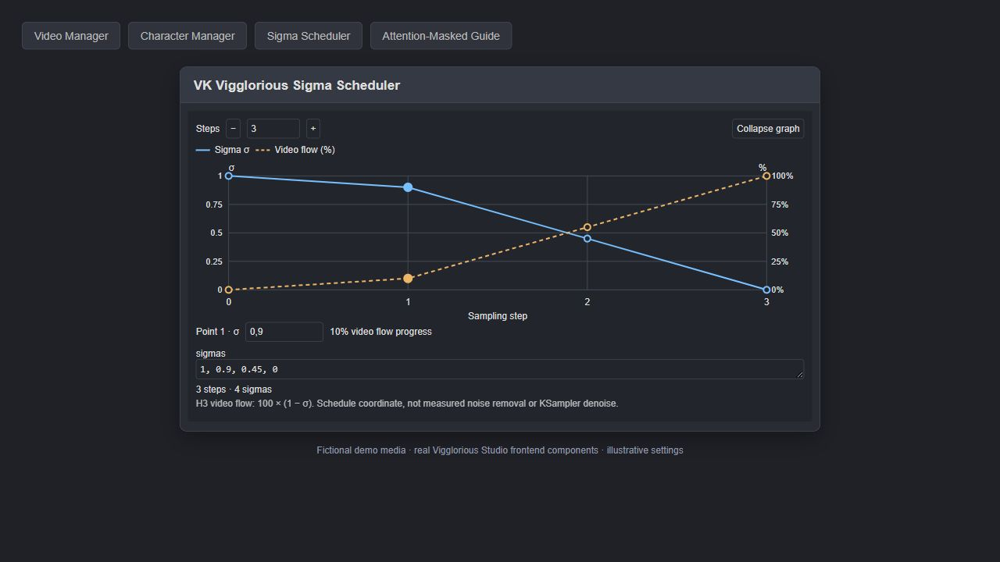

# VK Vigglorious Studio

**Character swapping for Viggle-Animate in ComfyUI, with per-chunk references and attention-controlled visual guides.**

VK Vigglorious Studio adds a character library, a video/chunk editor, a swap-and-guide pipeline, and per-step attention and sigma controls to [ComfyUI-Viggle-Animate-H3](https://github.com/bhardwajRahul/ComfyUI-Viggle-Animate-H3). Its goal is to keep a swapped character consistent across changes in pose, expression, camera angle and clothing while retaining Viggle's source motion.

The [included ComfyUI workflow](workflow/Vigglorious-Studio.json) uses **Qwen Image 2.1** and the excellent [BFS — Best Face Swap head and body LoRAs](https://huggingface.co/Alissonerdx/BFS-Best-Face-Swap) by **[Alissonerdx](https://huggingface.co/Alissonerdx)**. Their impressive results were a major motivation for creating VK Vigglorious Studio in the first place. The guide pipeline also accepts images produced by other compatible editing workflows.

> **Experimental:** the underlying concept works in practice: per-chunk references and attention-controlled swapped guides can improve character consistency. The ideal **sampler/scheduler, sigmas, number of sampling steps and guide-attention ratios** have yet to be established through practical testing. The settings in the workflow work, but they are neither failproof nor based on thousands of generations.

## Walkthrough: from character to finished video

This is the end-to-end path through the **included workflow**.

### 1. Set up a character

Open **VK Vigglorious Character Manager** and create or select a character. Add head reference images for the available viewing angles; optionally add full-body images for clothing, silhouette and body swaps. Save the character; it will be available for selection in **VK Vigglorious Video Manager**.



### 2. Load and cut the driving video

In **VK Vigglorious Video Manager**, load the source video, adjust processing resolution and frame rate, and mark the start/end of the sequence to process. Review the chunk boundaries on the timeline. The video provides the movement and composition; your edited frames provide the replacement appearance.

You can use **Show only cut** to focus on the selected range and **Export cut** to save the trimmed clip with source audio.

### 3. Work chunk by chunk: choose a reference, then add guides

For **chunk 1**, seek to a suitable video frame and select a character. Use the head/body **angle buttons** to choose the matching reference view. Choose **Head**, **Full body**, or **Full body then Head**, and add an **Additional prompt** when a swap needs extra instructions. Reusable text can be inserted using **Prompt shortcuts...**.

Set **Chunk Ref Frame ? → YES** before creating that selection to make it the chunk's **reference image**. Alternatively, select an existing guide and press **Chunk Ref** to promote it. The reference goes through the native image-reference conditioning path for its chunk.

Then add **ordinary guides** at other useful timestamps in the chunk: select the character and reference angles, choose a swap mode and optionally supply additional prompts. These edited frames become attention-controlled guides during video generation.

Move on to **chunk 2**, **chunk 3**, and so on. Assign a local reference where needed and place guides at poses or camera angles that benefit from extra control. If a chunk has no assigned reference, the nearest chunk's reference is reused (ties go to the earlier chunk). Reference frames are marked by thick red timeline cursors.



**Important distinction:** a **chunk reference** is the primary reference image for its chunk; an **ordinary guide** adds position-aware conditioning with optional masks and per-step attention. Removing ordinary guides does not remove chunk references; use **Remove All Guides and Reference Images** to clear both.

### 4. Set masks, attention and sigmas

In **VK Vigglorious Attention-Masked Guide**, select how guides influence the video. Use **VK Vigglorious Guide Mask** / SAM3 for a head/hair or person mask, or disable masking to use the full guide image. 

Set the **per-step ON/OFF switches** and **attention factors**. For a three-step run, `0.5 / 2 / 2` is an example schedule: lighter initial guide influence, stronger influence later. `1` is the neutral attention factor; `2` is not “200% likeness.” OFF removes the corresponding guides for that step, whereas ON with a zero factor can still keep their tokens present.

In **VK Vigglorious Sigma Scheduler**, set the sigma curve shared by the sampler and per-step attention controls. A three-step run needs four sigma values; for example, `1, 0.9, 0.45, 0`. The sigma curve determines *when* each step operates, not a directly measured percentage of denoising. Match the attention schedule length to the number of sampling steps.





### 5. Run the workflow and monitor each chunk

Queue the workflow. The chunk loop processes the cut **one chunk at a time**; the current chunk's selected frames are swapped and supplied as references/guides before its video is sampled.

While it runs, you can follow the pipeline at several points:

1. **Swap outputs / VK Vigglorious Attention-Masked Guide:** inspect the swapped guide images and their masks/guide overlays. This is where to spot a wrong viewing angle, a bad head/body swap or an overly broad mask.
2. **VK Vigglorious Extract Chunk State** (workflow node type `VKViggleChunkInfo`): see which chunk is being prepared and its current loop/sampling state.
3. **ModelPreviewOverrideKJ:** watch the model's sampling preview as the chunk is generated. It is a sampling preview, not the final decoded clip.
4. **Intermediate `VHS_VideoCombine`** (chunk output): watch the **decoded, completed chunk** before the loop advances.
5. **ViggleAssembleChunkLatents → final `VHS_VideoCombine`:** once all chunks are finished, the workflow assembles the chunk latents and outputs the **stitched video**.

The loop's **VK Vigglorious Chunk Finish** also stores chunk latents in `ComfyUI/output/viggle_chunks/<run_name>` so the intermediate outputs can be recovered. Re-queuing the supplied external-sampler workflow starts sampling again from chunk 1.

## Practical tips

Lessons from hands-on Viggle + Qwen/BFS experiments:

- **Make each chunk's reference count.** Choose a clear frame from the driving video, then check the swap carefully. Keep its original **pose, expression, framing, lighting and background** as close as possible. The chunk reference is the foundation; ordinary guides reinforce it.
- **Place guides where Viggle needs help.** Useful spots include difficult side angles, a face reappearing after an occlusion, and changes in apparent identity or clothing. Adding guides everywhere can be counterproductive.
- **Start with lighter early-step guide attention.** Strong attention at high sigma can interfere with motion or composition. An experimental starting point is around `0.5` for the first step and `2` for later steps. These are attention factors—not percentages of identity retention—and remain experimental.
- **Three steps work; four may also be worth exploring.** The best step count, scheduler and sigma curve are not settled.
- **Treat head and body swaps differently.** BFS body swaps have proved less reliable than head swaps in testing. A useful approach is **Body then Head** for a chunk reference, followed by **Head** swaps for ordinary guides, with head/hair masks concentrating attention where needed.
- **Use frame-specific additional prompts.** Examples include `eyes closed` or `looking toward the camera` when these match the selected source frame. Store recurring instructions under **Prompt shortcuts...**. You can also add `remove watermarks, remove text` to swap prompts when appropriate.

## How reference images and guides work

[Viggle-Animate](https://huggingface.co/Viggle/Viggle-Animate) is built on MiniMax H3 ref2va and transfers source-video movement to a new character appearance. Studio supplies two complementary visual paths:

| | Chunk reference | Ordinary guide |
|---|---|---|
| **Role** | Main appearance reference for a chunk | Reinforce selected views/edits through the video |
| **Source** | A selected, edited frame of the driving video | Other selected, edited source frames |
| **Conditioning** | Native reference-image path | H3 video-VAE-encoded guide tokens at chosen video positions |
| **Controls** | Local chunk assignment / fallback | Optional SAM3 mask, per-step ON/OFF and attention factors |

Guides are **not pasted onto the result**. Their encoded visual tokens are positioned in the sequence and influence the generation through attention; a guide can affect more than its own timestamp. A mask restricts which guide regions receive direct attention, but does not fix errors already present in a swapped image.

If a chunk has no local reference assignment, the nearest assigned chunk reference is reused. If none is assigned, the global reference remains available. The `reuse_initial_reference` option avoids processing an already-swapped initial reference again.

Use **an edited frame of the driving video** as Viggle's reference, rather than an unrelated character portrait. Character portraits belong in the image-editing subgraph as identity inputs.

## Included nodes

| Node | Purpose |
|---|---|
| **VK Vigglorious Character Manager** | Character library with head and optional full-body reference angles. |
| **VK Vigglorious Video Manager** | Video load, trim, chunk timeline, local chunk references, guides, prompts and angle selection. |
| **VK Vigglorious Load Image** | Standalone image loader for an optional existing reference. |
| **VK Vigglorious Extract Chunk State** | Current chunk conditioning, latents, noise, seed and frame count (`VKViggleChunkInfo`). |
| **VK Vigglorious Prepare Chunk Guides** | Frame selection and swap inputs for the current chunk, including guide positions. |
| **VK Vigglorious Extract Chunk Frames** | Source chunk frames for optional source-frame masking experiments. |
| **VK Vigglorious Guide Mask** | SAM3 segmentation of selected swapped guides. |
| **VK Vigglorious Attention-Masked Guide** | H3 guide encoding, optional masks, per-step guide attention. |
| **VK Vigglorious Patch Guide Attention** | Enables per-step guide attention controls. |
| **VK Vigglorious Sigma Scheduler** | Editable sampling sigma curve. |
| **VK Vigglorious Chunk Finish** | Stores finished chunk latents, advances the loop and exposes chunk preview latents. |

## Installation

1. Install a recent [ComfyUI](https://github.com/Comfy-Org/ComfyUI) with native H3, Qwen Image 2.1 and SAM3 support.
2. Install [ComfyUI-Viggle-Animate-H3](https://github.com/bhardwajRahul/ComfyUI-Viggle-Animate-H3) with the Viggle model, H3 video VAE and frozen text conditioning.
3. Clone this repository into `ComfyUI/custom_nodes`:

   ```bash
   git clone https://github.com/Tablaski/VK-Vigglorious-Studio.git VK-Vigglorious-Studio
   ```

4. Install **FFmpeg with libx264**. The video loader looks at `VHS_FORCE_FFMPEG_PATH`, then system `PATH`, then `imageio_ffmpeg` (installable with `python -m pip install imageio-ffmpeg` using ComfyUI's Python).
5. Install the [workflow dependencies](#packages-used-by-the-included-workflow) and [models](#models-and-loras). Restart ComfyUI completely, refresh the browser and load [`workflow/Vigglorious-Studio.json`](workflow/Vigglorious-Studio.json).

Nodes appear under **VK / Viggle**. There is no separate `requirements.txt`. The native SAM3 Python module is required to import Studio; SAM3 weights are needed for segmentation, not for unmasked guides.

### Packages used by the included workflow

| Package | Used for |
|---|---|
| [ComfyUI](https://github.com/Comfy-Org/ComfyUI) | Native H3, Qwen Image 2.1, SAM3, core loaders/samplers. |
| [ComfyUI-Viggle-Animate-H3](https://github.com/bhardwajRahul/ComfyUI-Viggle-Animate-H3) | Windowed conditioning, frozen text conditioning, chunk loop and assembly. |
| [ComfyUI-KJNodes](https://github.com/kijai/ComfyUI-KJNodes) | `LazySwitchKJ`, `GrowMaskWithBlur`, `ModelPreviewOverrideKJ`. |
| [rgthree-comfy](https://github.com/rgthree/rgthree-comfy) | Power LoRA Loader, image comparers and group toggles. |
| [Rebalance Pack](https://github.com/nova452/Rebalance-Pack) | `Switch` for reference-image routing. |
| [VideoHelperSuite](https://github.com/Kosinkadink/ComfyUI-VideoHelperSuite) | Intermediate/final `VHS_VideoCombine` and output pruning. |

The included example uses two Qwen swap subgraphs. Other image-editing models can replace them if they provide compatible swapped guide images. The example outputs source audio rather than decoding generated H3 audio.

### Models and LoRAs

The workflow does **not** automatically download weights. Select the installed files in all loaders, including those inside the Qwen subgraphs.

| Folder under `ComfyUI/models/` | Example filename | Source |
|---|---|---|
| `diffusion_models/` | `minimax_h3_ref2va_viggle_pruned_int8_convrot.safetensors` | [Viggle](https://huggingface.co/drbaph/Viggle-Animate-ComfyUI/tree/main/diffusion_models) |
| `loras/` | `viggle_animate_dmd_lora_r64.safetensors` | [Viggle DMD](https://huggingface.co/drbaph/Viggle-Animate-ComfyUI/tree/main/loras) |
| `text_cond/` | `fixed_embed_fwd_anyframe.safetensors` | [Frozen conditioning](https://huggingface.co/drbaph/Viggle-Animate-ComfyUI/tree/main/text_cond) |
| `vae/` | `minimax_h3_video_vae_fp16.safetensors` | [H3 VAEs](https://huggingface.co/Comfy-Org/MiniMax-H3/tree/main/vae) |
| `diffusion_models/` | `qwen_image_2.1_int8_convrot.safetensors` | [Qwen Image 2.1](https://huggingface.co/Comfy-Org/Qwen-Image-2.1/tree/main/diffusion_models) |
| `text_encoders/` | `qwen3vl_8b_int8_convrot.safetensors` | [Qwen text encoder](https://huggingface.co/Comfy-Org/Qwen-Image-2.1/tree/main/text_encoders) |
| `vae/` | `qwen_image_2.1_vae_bf16.safetensors` | [Qwen VAE](https://huggingface.co/Comfy-Org/Qwen-Image-2.1/tree/main/vae) |
| `loras/` | `bfs_head_v1.1_qwen_2.1.safetensors` | [BFS head swap](https://huggingface.co/Alissonerdx/BFS-Best-Face-Swap/blob/main/bfs_head_v1.1_qwen_2.1.safetensors) |
| `loras/` | `bfs_body_swap_v1.0_qwen_2.1.safetensors` | [BFS body swap](https://huggingface.co/Alissonerdx/BFS-Best-Face-Swap/blob/main/bfs_body_swap_v1.0_qwen_2.1.safetensors) |
| `loras/` | `p_qwen_image_2.1_8step_v0.1_comfyui.safetensors` | [Pruna ComfyUI conversion](https://huggingface.co/NidAll/pruna-image-2.1-comfyui-loras) / [original](https://huggingface.co/PrunaAI/Pruna-Qwen-Image-2.1) |
| `checkpoints/` | `sam3.1_multiplex_fp16.safetensors` | [SAM3.1](https://huggingface.co/Comfy-Org/sam3.1/tree/main/checkpoints) |

The supplied eight-step Qwen swap subgraphs enable the Pruna LoRA. The example uses H3 video decoding and saves the source audio; the H3 audio VAE is not required for this example.

## Video Manager notes

**Chunk references:** the **Chunk Ref Frame ?** selector resets after a reference is created. Existing guides can be promoted using **Chunk Ref**. A reference cannot be moved to another chunk. Borrowed references are indicated in the interface. **Remove Chunk Guides** and **Remove All Guides** preserve references.

**Character variants:** **Clone character** creates an unsaved character with independent angle IDs but shared image files. Save the clone after changing its images or label. **Global resize · performance** controls reference-image sizing across characters.

**Player and previews:** **Player preview max resolution** offers 480p, 720p (default), 1080p and Original. Video Manager caches a navigable H.264 source preview; guide extraction still uses the original video at processing resolution. Logs prefixed `[VK Video]` report import/preview stages. For HTTP 413 uploads, increase ComfyUI `--max-upload-size` or place the source in `ComfyUI/input`.

## Credits and license

Built on [ComfyUI](https://github.com/Comfy-Org/ComfyUI), [ComfyUI-Viggle-Animate-H3](https://github.com/bhardwajRahul/ComfyUI-Viggle-Animate-H3) and [MiniMax H3](https://huggingface.co/Comfy-Org/MiniMax-H3). Swaps in the included workflow use [Qwen Image 2.1](https://huggingface.co/Comfy-Org/Qwen-Image-2.1). **Special thanks to [Alissonerdx](https://huggingface.co/Alissonerdx)** for creating the excellent [BFS — Best Face Swap LoRAs](https://huggingface.co/Alissonerdx/BFS-Best-Face-Swap), which inspired and motivated the creation of this project. The video loader includes FFmpeg helpers adapted from VK Load Video FFMPEG.

The code is licensed under [GPL-3.0](LICENSE). Models, LoRAs, other extensions and media retain their own licenses; their weights are not distributed here.
